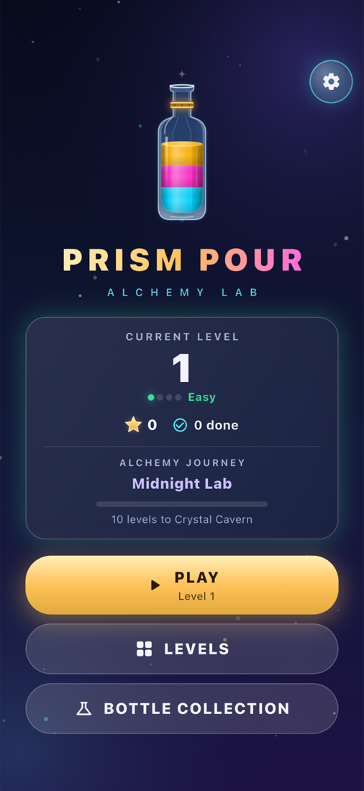
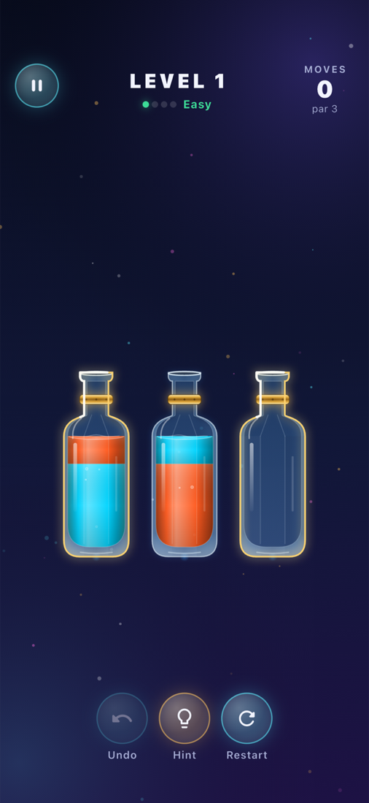
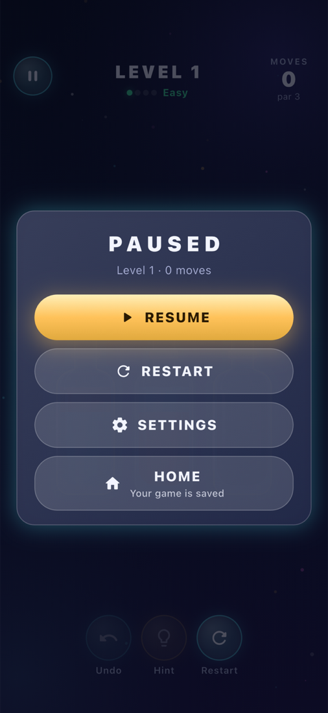
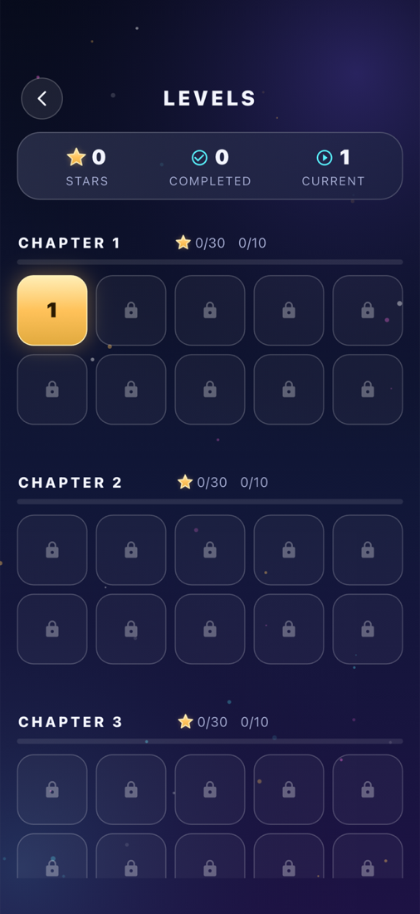
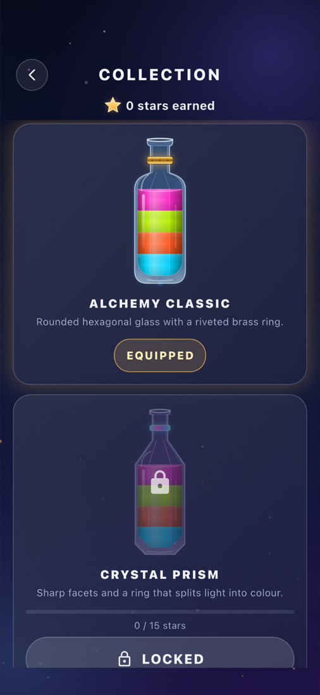
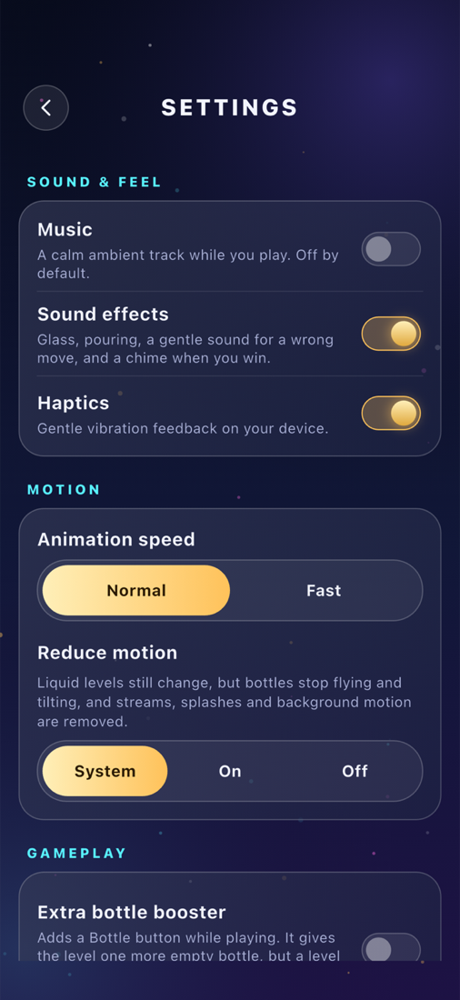

<div align="center">

# 🧪 Prism Pour — Alchemy Lab

**A premium, fully offline bottle-sorting puzzle game built with Flutter.**

Pour glowing potions between glass flasks until every flask holds a single colour.






</div>

---

## 📸 Screenshots

| Home | Gameplay | Hint |
|:---:|:---:|:---:|
|  |  |  |
| Continue where you left off, track stars and your Alchemy Journey | Tap a flask, then tap where to pour | The solver highlights the next best pour |

| Pause | Levels | Collection | Settings |
|:---:|:---:|:---:|:---:|
|  |  |  |  |
| Board locks, nothing is lost | Chapters of ten, unlocked in order | Unlock new flask designs with stars | Sound, music, gameplay options |

## 🎮 How to play

1. **Tap a flask** to pick up its top layer of liquid.
2. **Tap another flask** to pour into it.
3. A pour is allowed only if the target flask has free space and is **empty or has the same colour on top**.
4. The level is solved when **every flask is empty or completely full of one colour**.

Fewer moves earn more stars: **3★** for a near-perfect solution, **2★** for a good one, **1★** for solving it at all.

## ✨ Features

- **Endless levels** – procedurally generated, deterministic per level number, and every level is verified solvable by the built-in solver.
- **Smart difficulty curve** – more colours, flasks and tighter space as you progress.
- **Undo, Restart, Hint & Pause** – all free. Hints come from the real solver and never play the move for you.
- **Optional extra bottle** – a booster (off by default) that adds one empty flask.
- **Star rating** based on a computed *par* for each level.
- **Alchemy Journey** – the lab gains colour and light chapter by chapter as you play.
- **Bottle collection** – unlock new flask styles with the stars you earn.
- **Hand-drawn glass & liquid** – every flask, refraction highlight, bubble and pour animation is painted with `CustomPainter`; no copied artwork.
- **Sound & music** – bundled pour, clink, unlock and ambient audio.
- **Saves progress automatically** – resume an unfinished level exactly where you stopped.
- **100% offline** – no accounts, no ads, no in-app purchases, no backend.

## 🧱 Tech stack

| Area | Choice |
|---|---|
| Framework | Flutter / Dart |
| State management | [flutter_riverpod](https://pub.dev/packages/flutter_riverpod) |
| Navigation | [go_router](https://pub.dev/packages/go_router) |
| Storage | [sqflite](https://pub.dev/packages/sqflite) + [shared_preferences](https://pub.dev/packages/shared_preferences) |
| Audio | [audioplayers](https://pub.dev/packages/audioplayers) |
| Rendering | `CustomPainter` (no game engine) |

## 🏗️ Architecture

The puzzle rules live in a **pure Dart engine** with no Flutter imports, so it is fast to test and can run in an isolate.

```
lib/
├── app/        MaterialApp.router, routes, theme
├── core/       constants and small utilities
├── engine/     pure Dart: models, rules, solver, level generator, progression
├── data/       SQLite database and repositories
├── features/   home, game, levels, collection, settings, journey, audio, effects…
└── shared/     reusable widgets
```

More detail in [`docs/`](docs):

- [Game design](docs/game-design.md)
- [Architecture](docs/architecture.md)
- [Development roadmap](docs/development-roadmap.md)

## 🚀 Getting started

**Requirements:** Flutter SDK with Dart `^3.13.2`, plus Xcode (iOS) or Android Studio (Android).

```bash
# clone
git clone https://github.com/hilalahmad0101/bottle-puzzle-game-flutter.git
cd bottle-puzzle-game-flutter

# install dependencies
flutter pub get

# run on a connected device or emulator
flutter run
```

### Build a release

```bash
flutter build apk --release        # Android APK
flutter build appbundle --release  # Android App Bundle
flutter build ios --release        # iOS (requires Xcode & signing)
```

## 🧪 Tests

```bash
flutter test                                  # unit and widget tests
flutter test integration_test                 # full app flow on a device/simulator
```

The suite covers the engine rules, solver, level generator, save/restore codec, rendering, audio, progression and UI flows.

## 📁 Regenerating audio

Sound effects are generated by [`tool/generate_audio.py`](tool/generate_audio.py) into `assets/audio/`.

## 🤝 Contributing

Issues and pull requests are welcome. Please run `flutter test` before opening a PR.

---

<div align="center">Made with Flutter 💜</div>
